# BukuKita — Aplikasi Web Pemesanan Toko Buku Online
> **Tugas Ujian Tengah Semester (UTS) — Pemrograman Web 1**  
> **Nama Mahasiswa / Pengembang:** Muhammad Alghofiqi  
> **Status:** Selesai (Memenuhi Seluruh Kriteria Penilaian Akademik)

---

## 1. Deskripsi Proyek
**BukuKita** adalah aplikasi web *front-end* pemesanan buku toko online yang dibangun murni menggunakan teknologi web standar (**Vanilla HTML5, CSS3, dan JavaScript ES6+**). Aplikasi ini dirancang tanpa ketergantungan pada *library*, *framework*, *build tool*, maupun jaringan CDN eksternal, sehingga dapat langsung dijalankan secara luring (*offline*) hanya dengan melakukan *double-click* pada berkas `index.html`.

Aplikasi ini mengusung estetika desain editorial butik toko buku yang bersih, tenang, dan nyaman di mata (*eye-friendly*):
- **Latar Belakang:** *Soft Natural Cotton Paper* (`#f9f8f5`) yang tidak silau.
- **Tipografi:** Kombinasi *Charter/Georgia* untuk judul editorial dan *System-UI* bersih untuk keterbacaan data.
- **Pewarnaan:** *Deep Ink Slate* (`#1c2e3d`) dan *Warm Terracotta* (`#b85d24`) tanpa warna neon.
- **Pengalaman Pengguna Ramah Pelanggan:** Pengguna yang masuk (`fal@bukukita.com`) langsung disambut di **Beranda Toko Buku** dengan etalase buku unggulan yang bisa langsung dipesan ke keranjang.

---

## 2. Cara Menjalankan Aplikasi
1. Buka folder proyek `UTS_Buku`.
2. Klik dua kali (*double-click*) berkas **`index.html`** untuk membukanya langsung di peramban web (*Google Chrome, Microsoft Edge, Mozilla Firefox, atau Safari*).
3. Tidak memerlukan server lokal seperti Apache/XAMPP, Node.js, maupun ekstensi Live Server.

---

## 3. Akun Demo & Data Pengujian

### A. Akun Login (`index.html`)
| Nama Pengguna | Alamat Email | Kata Sandi | Keterangan |
|---|---|---|---|
| **Fal** | `fal@bukukita.com` | `fal12345` | Akun Pelanggan Utama |
| **Administrator** | `admin@bukukita.com` | `admin123` | Akun Pengelola Toko |
| **Siti Rahma** | `siti@bukukita.com` | `siti12345` | Akun Pelanggan |

*Catatan: Anda juga dapat mendaftar akun baru melalui tombol **Daftar Akun Baru**; data tersimpan di `localStorage` dan dapat langsung digunakan untuk masuk.*

### B. Nomor Delivery Order (DO) Demo (`tracking.html`)
| Nomor DO | Nama Pemesan | Ekspedisi & Layanan | Status Pengiriman | Progress |
|---|---|---|---|---|
| `DO-2026-0001` | Budi Santoso | JNE (Reguler) | **Terkirim** | 100% |
| `DO-2026-0002` | Siti Rahma | J&T Express (Express) | **Dalam Perjalanan** | 80% |
| `DO-2026-0003` | Andi Pratama | SiCepat (Reguler) | **Dikirim** | 60% |
| `DO-2026-0004` | Dewi Anggraini | AnterAja (Reguler) | **Dikemas** | 40% |
| `DO-2026-0005` | Rizky Maulana | JNE (Express) | **Diproses** | 20% |

*Catatan: Setiap pesanan baru yang dibuat di `checkout.html` akan otomatis menerbitkan nomor DO unik (misal `DO-2026-0006`, dst.) dan langsung terlacak di sistem.*

---

## 4. Struktur Folder & Berkas Resmi
```
UTS_Buku/
|-- index.html              # Halaman Masuk (Login, modal Lupa Password & Daftar)
|-- dashboard.html          # Beranda Toko Buku (Sapaan jam, etalase rekomendasi, modal laporan & history)
|-- stok.html               # Katalog Buku & Stok (Form tambah stok via DOM, filter kategori, cari)
|-- checkout.html           # Keranjang & Checkout (Ubah qty, form pemesan & DO generator)
|-- tracking.html           # Pelacakan Pengiriman (Progress bar bertahap 20%-100% & timeline)
|-- css/
|   `-- style.css           # CSS Eksternal Bersih (Tokens, layout, tipografi, tabel, modal, toast)
|-- js/
|   |-- data.js             # Data awal dummy (dataKatalogBuku, dataPengguna, dataPengiriman, dataPesanan)
|   `-- script.js           # Logika interaktivitas JS, validasi form, manipulasi DOM, localStorage
|-- assets/
|   `-- logo.png            # Logo resmi BukuKita
|-- img/
|   |-- placeholder.svg     # Fallback cover buku
|   `-- buku1.png s/d buku12.png # Aset sampul buku asli
|-- screenshots/            # 12 Bukti tangkapan layar setiap proses untuk laporan UTS
`-- README.md               # Dokumentasi lengkap & outline skrip video UTS
```

---

## 5. Dokumentasi Tangkapan Layar Proses (Folder `screenshots/`)

Setiap alur dan proses penting telah didokumentasikan dalam format gambar resolusi tinggi (1280x820) untuk kelengkapan laporan tugas UTS:

### 1. Autentikasi & Validasi Form (`index.html`)

**01. Halaman Masuk / Login**
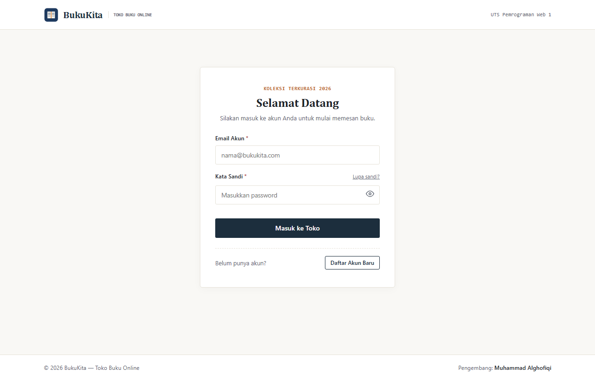

**02. Modal Pemulihan Kata Sandi**
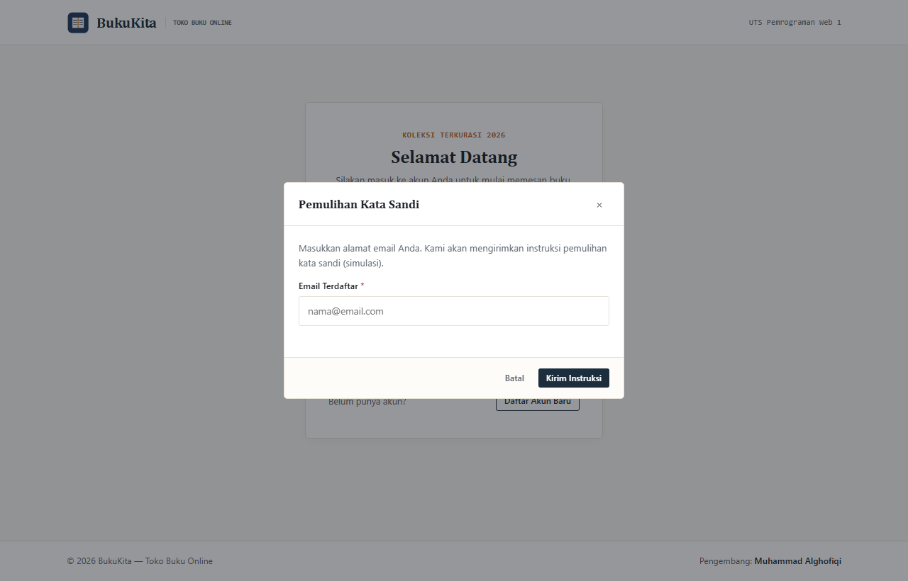

**03. Modal Registrasi Akun Pelanggan Baru**
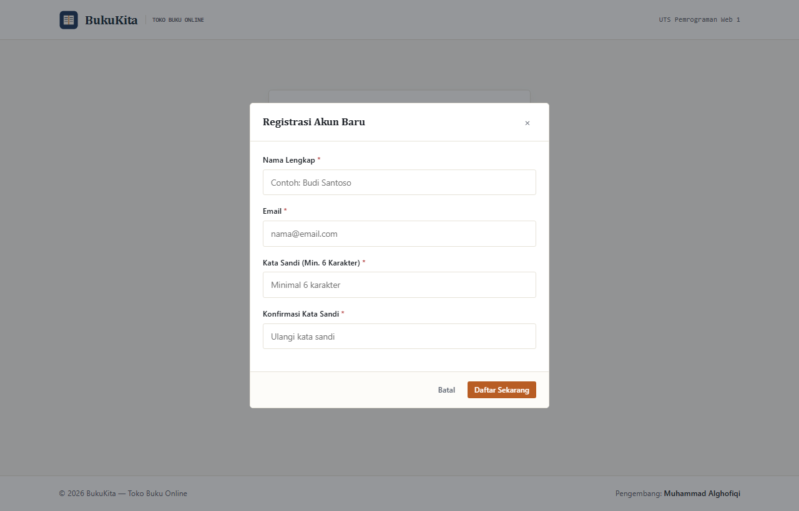

**04. Validasi Form Login (Peringatan Galat Kredensial)**
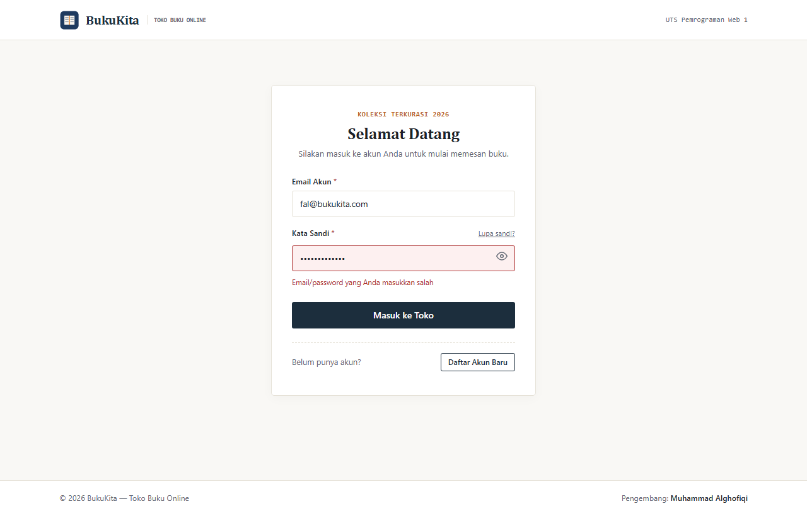

---

### 2. Beranda Pelanggan & Rekapitulasi (`dashboard.html`)

**05. Tampilan Beranda Toko Buku Pelanggan**
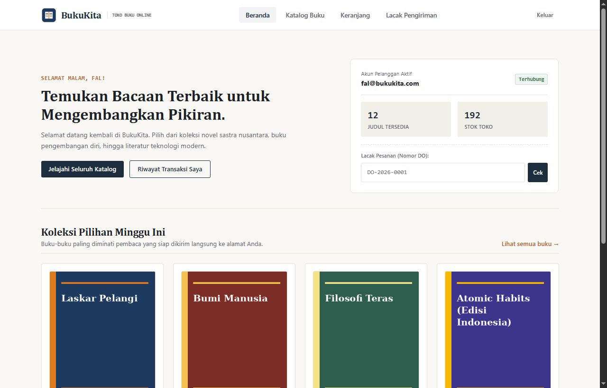

**06. Modal Riwayat Transaksi Pelanggan**
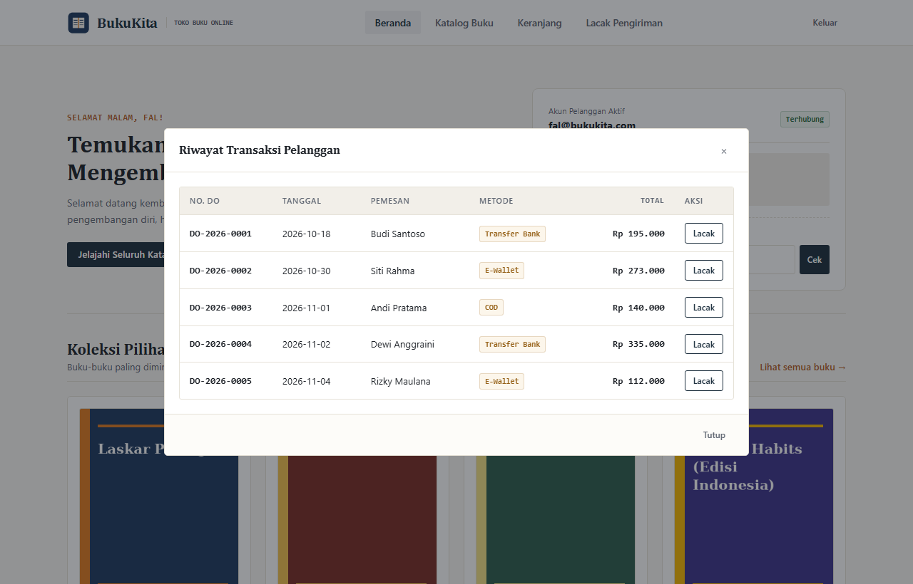

**07. Modal Laporan Rekapitulasi Pemesanan Toko**
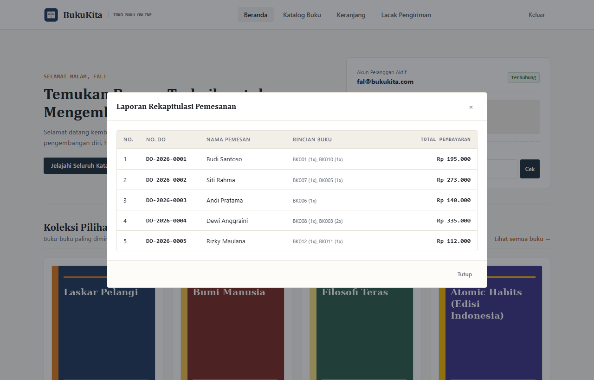

---

### 3. Katalog Koleksi & Stok Buku (`stok.html`)

**08. Halaman Katalog & Pencarian/Filter Stok Buku**
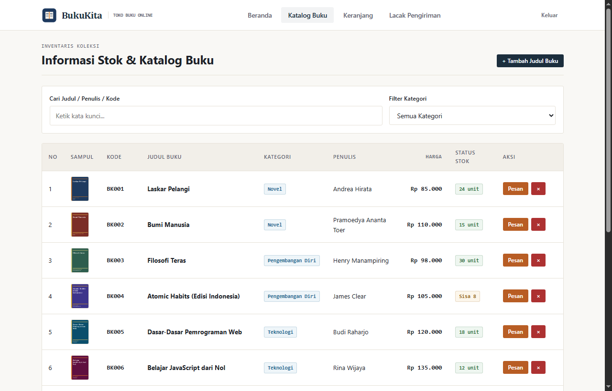

**09. Modal Tambah Judul Buku Baru ke Katalog**
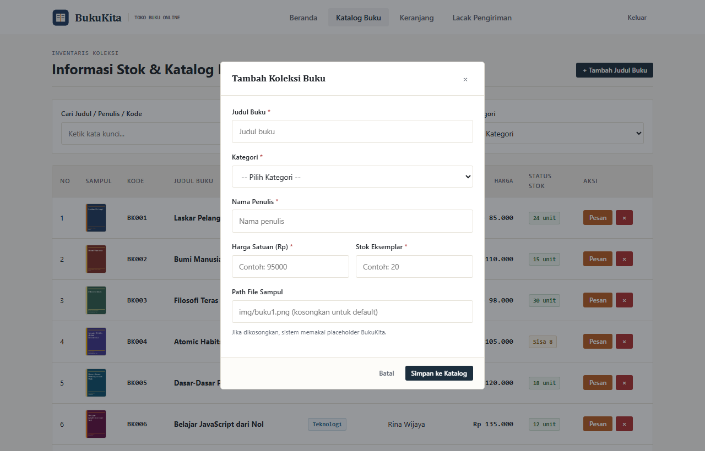

---

### 4. Keranjang Belanja & Checkout (`checkout.html`)

**10. Halaman Checkout & Keranjang Belanja**
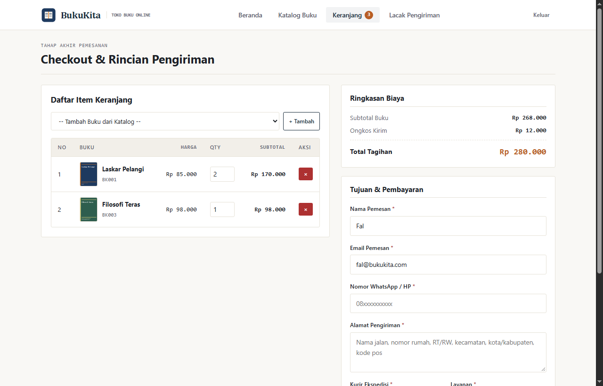

**11. Modal Konfirmasi Final Pemesanan**
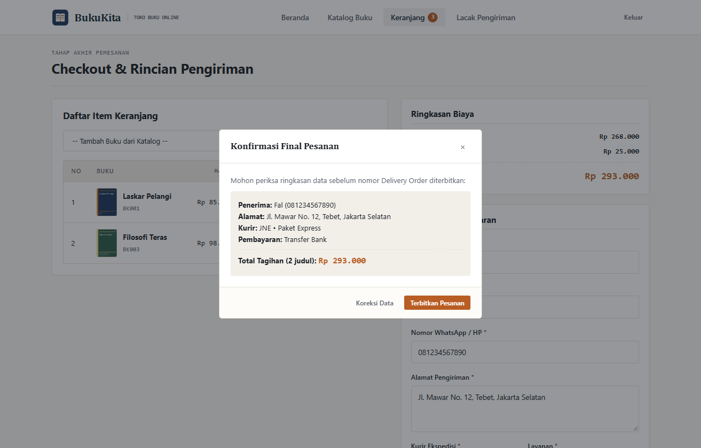

---

### 5. Pelacakan Pengiriman Delivery Order (`tracking.html`)

**12. Halaman Tracking Pengiriman (Progress Bar & Log Timeline)**
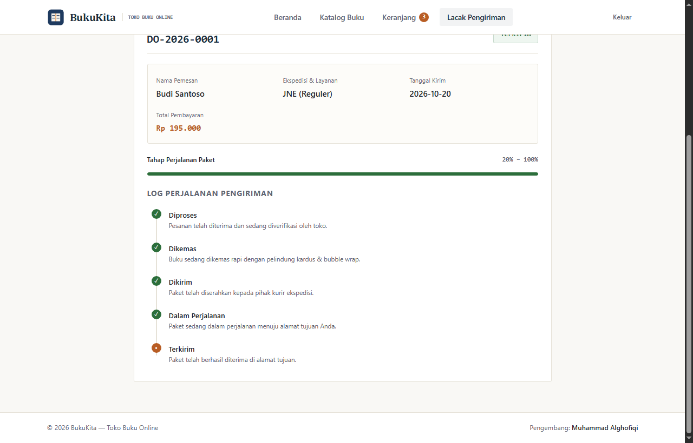

---

## 6. Pemenuhan 3 Indikator Penilaian UTS

### Indikator 1: HTML Semantik dan Valid
- Menggunakan struktur semantik standar HTML5: `<header>`, `<nav>`, `<main>`, `<section>`, `<article>`, `<form>`, `<table>`, `<thead>`, `<tbody>`, `<th>` (dengan atribut `scope="col"`), dan `<footer>`.
- Formulir dilengkapi `<label for="...">` yang terhubung langsung ke atribut `id` input terkait.
- Aksesibilitas ARIA: `role="dialog"`, `aria-modal="true"`, `aria-labelledby`, dan `role="navigation"`.
- Seluruh elemen gambar memiliki atribut `alt` deskriptif serta penanganan `onerror` menuju berkas fallback `img/placeholder.svg`.
- Di footer seluruh halaman tercantum identitas: **Muhammad Alghofiqi**.

### Indikator 2: Desain CSS (Eksternal, Internal, dan Inline)
1. **CSS Eksternal (`css/style.css`):**
   - Kode bersih tanpa bloatware, variabel CSS modular, tata letak Grid & Flexbox, breakpoint responsif pada layar ponsel (`≤ 768px`).
2. **CSS Internal (`<style>`):**
   - Terdapat pada berkas **`index.html`** lengkap dengan komentar penjelas untuk mengatur panggung masuk editorial.
3. **CSS Inline (`style="..."`):**
   - Terdapat pada elemen header **`index.html`** lengkap dengan komentar penjelas demonstrasi indikator UTS.

### Indikator 3: JavaScript Dinamis & Interaktivitas DOM
- **Manipulasi DOM:** Seluruh baris tabel katalog (`stok.html`), item keranjang (`checkout.html`), rak buku beranda (`dashboard.html`), laporan transaksi, serta timeline pengiriman dirender dinamis via JavaScript dari `data.js` tanpa data yang di-*hardcode* di HTML.
- **Validasi Form Lengkap:** Validasi nilai kosong, pola format surel reguler (*Regex*), nomor telepon numerik, dan kata sandi minimal 6 karakter.
- **Pesan Alert Spesifik:** Apabila kombinasi email/password keliru saat login, sistem memunculkan pesan wajib dosen: `alert("Email/password yang Anda masukkan salah")`.
- **Manajemen Sesi & State:**
  - `sessionStorage`: Menyimpan sesi pengguna aktif (`bukukita_user_session`) sebagai *route guard*.
  - `localStorage`: Menyimpan data keranjang belanja (`bukukita_keranjang`), katalog buku terbarui (`bukukita_katalog_data`), akun pendaftar baru (`bukukita_pengguna_tambahan`), serta riwayat transaksi baru (`bukukita_riwayat_pesanan` & `bukukita_pengiriman_data`).
- **Pengurangan Stok Otomatis:** Saat pesanan diselesaikan di checkout, stok buku berkurang secara riil di katalog.

---
*BukuKita &copy; 2026 — Dibuat oleh Muhammad Alghofiqi untuk UTS Pemrograman Web 1.*
